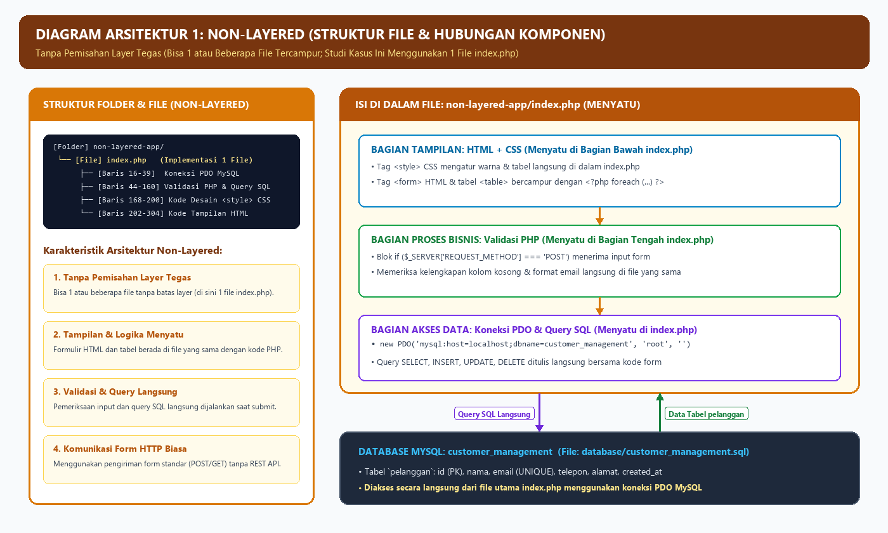
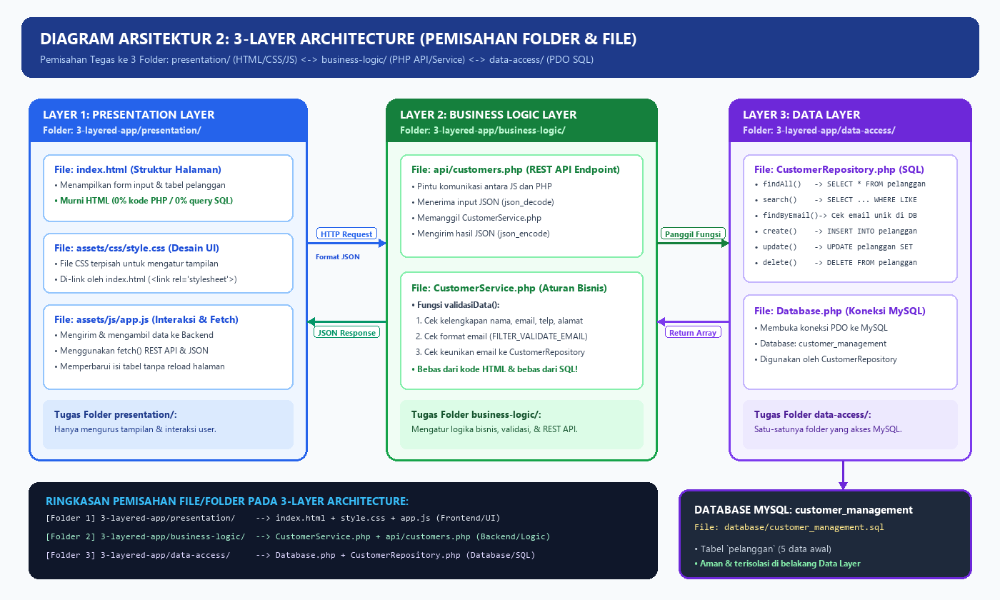
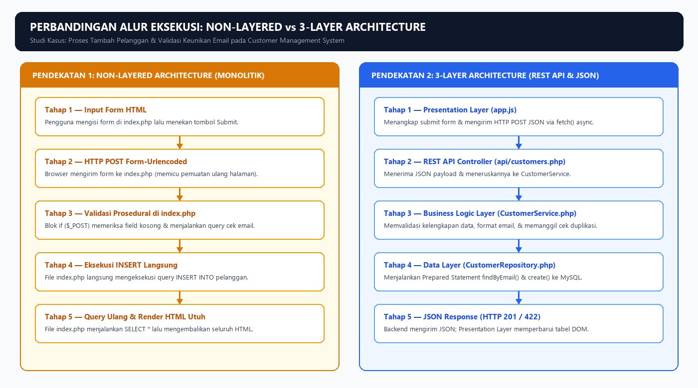
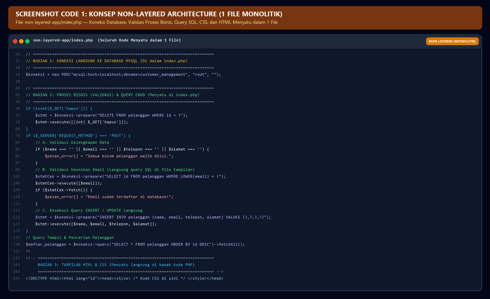
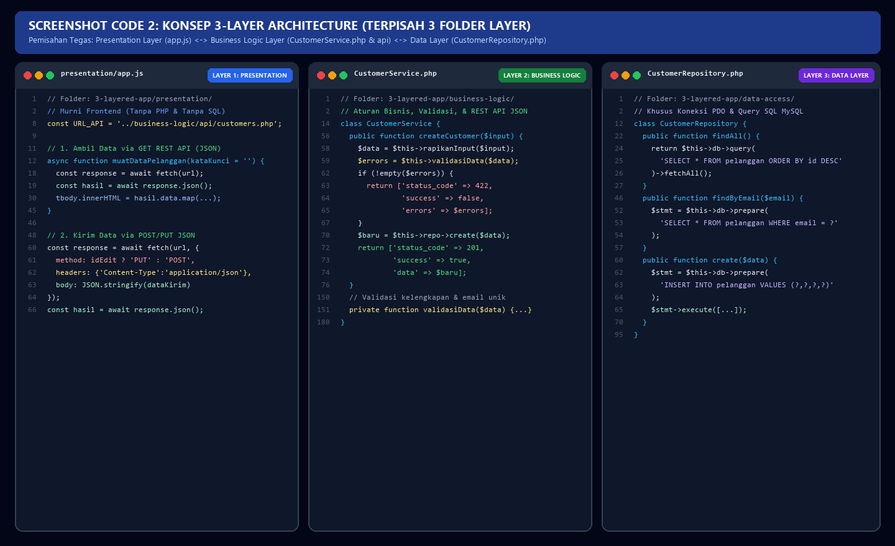

# Tugas Kelompok: Analisis & Implementasi Perbandingan Layered vs Non-Layered Web Application Architecture

**Studi Kasus:** Customer Management System (Sistem Pengelolaan Data Pelanggan Perusahaan)  
**Acuan Materi:** [`3-Layer Web Application Architecture.pdf`](./3-Layer%20Web%20Application%20Architecture.pdf) (Halaman 1–22)  
**Teknologi:** PHP Native (Tanpa Framework), MySQL (PDO), HTML, CSS, JavaScript Fetch API (REST & JSON)

---

## 1. Peta Seluruh Luaran Wajib (Sesuai Halaman 22 PDF & Arahan Dosen)

Seluruh **8 luaran wajib** telah selesai dibuat dan disesuaikan dengan arahan dosen:

| No. | Luaran yang Harus Dikumpulkan & Dipresentasikan | Lokasi File / Folder |
| :-: | :--- | :--- |
| **1** | **Source Code Aplikasi Non-Layered (Tanpa Pemisahan Layer Tegas)** | [`non-layered-app/index.php`](./non-layered-app/index.php) *(diimplementasikan dalam 1 file)* |
| **2** | **Source Code Aplikasi 3-Layer Architecture (3 Folder Layer)** | [`3-layered-app/`](./3-layered-app/) (`presentation/`, `business-logic/`, `data-access/`) |
| **3** | **File Database SQL (MySQL + 5 Data Awal)** | [`database/customer_management.sql`](./database/customer_management.sql) |
| **4** | **Diagram Arsitektur (Pemisahan File/Folder & Hubungan HTML/CSS/PHP/SQL)** | [`diagrams/`](./diagrams/) (Diagram Non-Layered, 3-Layer, & Alur Request) |
| **5** | **Screenshot Code & Screenshot Tampilan Web Kedua Aplikasi** | [`screenshots/`](./screenshots/) (2 Screenshot Code + 6 Screenshot Tampilan Web) |
| **6** | **Satu Tabel Utama Hasil Pengujian & Perbandingan Akhir** | [`pengujian/Tabel_Hasil_Pengujian_dan_Perbandingan.md`](./pengujian/Tabel_Hasil_Pengujian_dan_Perbandingan.md) |
| **7** | **Laporan Analisis (PDF)** | [`laporan/Laporan_Analisis_Layered_vs_Non_Layered_Architecture.pdf`](./laporan/Laporan_Analisis_Layered_vs_Non_Layered_Architecture.pdf) |
| **8** | **Slide Presentasi Kelompok (PPTX & PDF)** | [`presentasi/Slide_Presentasi_Kelompok_3Layer_vs_NonLayered.pptx`](./presentasi/Slide_Presentasi_Kelompok_3Layer_vs_NonLayered.pptx) & [`.pdf`](./presentasi/Slide_Presentasi_Kelompok_3Layer_vs_NonLayered.pdf) |

---

## 2. Diagram Arsitektur (Pemisahan File/Folder & Hubungan Komponen)

### A. Diagram Arsitektur 1: Non-Layered Architecture (Tanpa Pemisahan Layer Tegas; Studi Kasus Ini Menggunakan 1 File `index.php`)


### B. Diagram Arsitektur 2: 3-Layer Architecture (Terpisah Tegas ke 3 Folder)


### C. Diagram Perbandingan Alur Proses Request & Response


---

## 3. Screenshot Code (Mewakili Konsep Non-Layered vs 3-Layer)

### A. Screenshot Code Non-Layered (`non-layered-app/index.php`)
Secara konsep (Halaman 16 & 18 PDF), **Non-Layered Architecture** adalah aplikasi yang dikembangkan tanpa pemisahan layer secara tegas, di mana tampilan, proses bisnis, dan akses database **dapat berada dalam satu file atau beberapa file yang belum memiliki pemisahan tanggung jawab yang jelas**. Pada studi kasus ini (sesuai Halaman 14 & 20 PDF), seluruh kode ditempatkan di dalam **1 file (`index.php`)**:


### B. Screenshot Code 3-Layer (`presentation/`, `business-logic/`, `data-access/`)
Kode dipisahkan secara tegas sesuai tanggung jawab masing-masing folder layer dan berkomunikasi via **REST API & JSON**:


---

## 4. Tabel Hasil Pengujian & Perbandingan Akhir

Berikut adalah **Satu Tabel Utama Hasil Pengujian & Perbandingan** yang merangkum unsur-unsur yang diuji coba, perbandingan antara Tanpa Layer vs 3-Layer, siapa yang lebih unggul, beserta alasannya:

| No | Unsur yang Diuji Coba | Tanpa Layer (Non-Layered) | Menggunakan 3-Layer | Siapa yang Lebih Unggul? | Alasannya Kenapa? |
| :-: | :--- | :--- | :--- | :---: | :--- |
| **1** | **Struktur Pemisahan File & Folder** | Belum memiliki pemisahan tanggung jawab layer yang jelas (dapat berada dalam **1 file atau beberapa file** yang masih tercampur; pada studi kasus ini ditempatkan dalam **1 file** `non-layered-app/index.php`). | Terpisah tegas ke dalam **3 folder**: `presentation/` (UI), `business-logic/` (Service & API), dan `data-access/` (SQL). | **3-Layer Architecture** | Struktur kode sangat rapi dan setiap file/folder memiliki tanggung jawab layer yang jelas (*Separation of Concerns*). |
| **2** | **Kecepatan Pembuatan Awal (Aplikasi Kecil)** | **Sangat cepat** dibuat karena kode tampilan, proses bisnis, dan SQL langsung ditulis menyatu (di sini dalam `index.php`) tanpa perlu membuat endpoint API JSON. | Membutuhkan waktu awal lebih lama karena harus menyiapkan 3 folder, REST API (`customers.php`), dan `fetch()` JS. | **Non-Layered Architecture** | Untuk program kecil atau tugas sederhana, menulis kode tanpa pemisahan layer langsung jalan tanpa konfigurasi antar-layer. |
| **3** | **Pengerjaan Individu vs Kerja Tim** | Cocok dikerjakan **1 orang (individu)**, tetapi sulit bagi tim karena belum ada batas tanggung jawab layer yang jelas (apalagi pada implementasi 1 file `index.php` yang rawan *conflict*). | Sangat cocok untuk **kerja tim**. Anggota 1 mengerjakan folder `presentation/`, Anggota 2 di `business-logic/`, Anggota 3 di `data-access/`. | **3-Layer Architecture** | Setiap anggota tim bekerja di folder/layer yang berbeda sehingga tidak saling mengganggu pekerjaan anggota lain. |
| **4** | **Kemudahan Penelusuran Kesalahan (Debugging)** | **Sulit ditelusuri** karena ketika muncul error, kita harus mencari di antara ratusan baris HTML, PHP, dan SQL yang bercampur di 1 file. | **Sangat mudah dilacak** karena lokasi error langsung terisolasi sesuai foldernya (apakah di tampilan JS, validasi Service, atau query SQL). | **3-Layer Architecture** | Jika salah tampilan cek `presentation/`, jika salah aturan validasi cek `CustomerService.php`, jika salah query cek `CustomerRepository.php`. |
| **5** | **Kecepatan Respons Antarmuka (UI)** | Lebih lambat karena setiap tambah/edit/hapus/cari pelanggan harus **memuat ulang seluruh halaman** (*Full Page Reload*). | **Lebih cepat dan mulus** karena browser hanya mengirim & menerima data teks ringan berformat **JSON** via `fetch()` tanpa *reload* halaman. | **3-Layer Architecture** | Pertukaran data menggunakan REST API & JSON hanya memperbarui isi tabel HTML secara dinamis tanpa me-refresh seluruh halaman. |
| **6** | **Keamanan Saat Mengubah Desain Tampilan (HTML/CSS)** | **Rawan merusak program**, karena saat mengedit tag HTML/CSS di `index.php`, kita bisa tidak sengaja menghapus variabel PHP atau query SQL di atasnya. | **Sangat aman**, karena desainer web cukup mengedit `index.html` dan `style.css` yang murni berisi kode tampilan (0% kode PHP/SQL). | **3-Layer Architecture** | Kode tampilan di folder `presentation/` terpisah 100% dari logika bisnis PHP maupun query database MySQL. |
| **7** | **Kemudahan Penambahan Fitur Baru (Skalabilitas)** | Semakin banyak fitur baru ditambahkan, file `index.php` menjadi semakin panjang, rumit, dan sulit dipelihara (*spaghetti code*). | Mudah dikembangkan cukup dengan menambah fungsi baru di `CustomerRepository.php` dan `CustomerService.php` tanpa merusak kode lama. | **3-Layer Architecture** | Penambahan fitur baru terorganisir per layer sehingga aplikasi mudah dikembangkan untuk jangka panjang. |
| **8** | **Kemampuan Dipakai Ulang oleh Aplikasi Lain (Reusabilitas)** | **Tidak bisa** dipakai oleh aplikasi Mobile (Android/iOS) karena output dari `index.php` berupa halaman HTML utuh, bukan data JSON. | **Bisa langsung dipakai ulang** oleh aplikasi Android, iOS, atau sistem lain karena `api/customers.php` menghasilkan **JSON standar**. | **3-Layer Architecture** | Business Logic Layer menyediakan REST API berformat JSON yang dapat diakses lintas platform (Web & Mobile). |

---

## 5. Jawaban 5 Pertanyaan Diskusi (Halaman 17 PDF)

1. **Mana yang lebih mudah dibuat?**
   - **Aplikasi Non-Layered lebih mudah dan cepat dibuat di awal** untuk aplikasi kecil/individu, karena seluruh koneksi database, validasi, query SQL, dan tampilan HTML cukup ditulis di dalam satu file `index.php`.
2. **Mana yang lebih mudah diperbaiki ketika terjadi kesalahan (bug)?**
   - **Aplikasi 3-Layer jauh lebih mudah diperbaiki.** Karena tugas tiap layer sudah dipisah sesuai foldernya:
     - Kalau tampilan tombol/tabel berantakan $\rightarrow$ cukup periksa folder `presentation/`.
     - Kalau aturan validasi email salah $\rightarrow$ cukup periksa `CustomerService.php` di folder `business-logic/`.
     - Kalau query SQL salah $\rightarrow$ cukup periksa `CustomerRepository.php` di folder `data-access/`.
3. **Mana yang lebih mudah dikembangkan ketika fitur bertambah?**
   - **Aplikasi 3-Layer jauh lebih mudah dikembangkan.** Ketika fitur bertambah atau dikerjakan oleh tim, tiap layer dapat dikembangkan tanpa merusak bagian lain dan endpoint REST API JSON (`api/customers.php`) bisa dipakai ulang oleh aplikasi Mobile.
4. **Apa risiko jika seluruh kode ditempatkan dalam satu file?**
   - Kode menjadi panjang dan tercampur aduk (*spaghetti code*), mengubah desain HTML/CSS berisiko merusak query SQL, rawan bentrok saat dikerjakan oleh tim, dan sulit melacak letak bug.
5. **Apakah aplikasi tanpa 3-layer selalu lebih buruk?**
   - **Tidak selalu.** Untuk tugas individu, prototipe cepat, atau aplikasi sangat kecil, Non-Layered lebih praktis dan cepat selesai. Namun untuk aplikasi bisnis yang dikerjakan tim dan terus berkembang, **3-Layer Architecture mutlak lebih unggul**.

---

## 6. Cara Menjalankan Kedua Aplikasi

1. **Nyalakan Apache & MySQL** di XAMPP atau Laragon.
2. **Import Database SQL** ke MySQL / phpMyAdmin:
   - Buka `http://localhost/phpmyadmin`
   - Klik menu **Import** $\rightarrow$ pilih file [`database/customer_management.sql`](./database/customer_management.sql) $\rightarrow$ klik **Import / Go**.
   - *(Catatan: Kedua aplikasi juga sudah dilengkapi fitur **Auto-Create Database** sehingga jika database `customer_management` belum dibuat, aplikasi akan mengimpornya secara otomatis saat halaman dibuka).*
3. **Jalankan Aplikasi:**
   - Jika memakai folder `htdocs` XAMPP / `www` Laragon, langsung buka dari browser.
   - Atau jalankan langsung dari folder ini dengan perintah:
     ```powershell
     php -S localhost:8000
     ```
4. **Buka di Browser:**
   - **Aplikasi 1 (Non-Layered):** `http://localhost:8000/non-layered-app/index.php`
   - **Aplikasi 2 (3-Layer Architecture):** `http://localhost:8000/3-layered-app/presentation/index.html`
   - **Cek Output JSON REST API:** `http://localhost:8000/3-layered-app/business-logic/api/customers.php`
